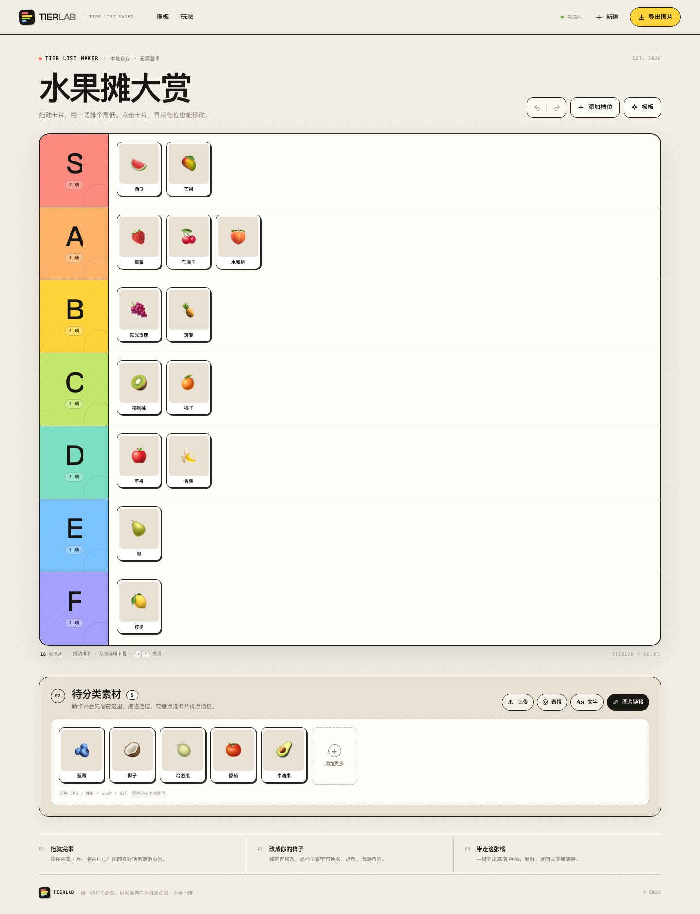
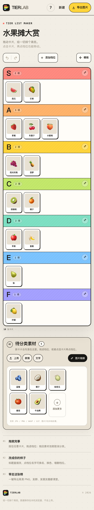
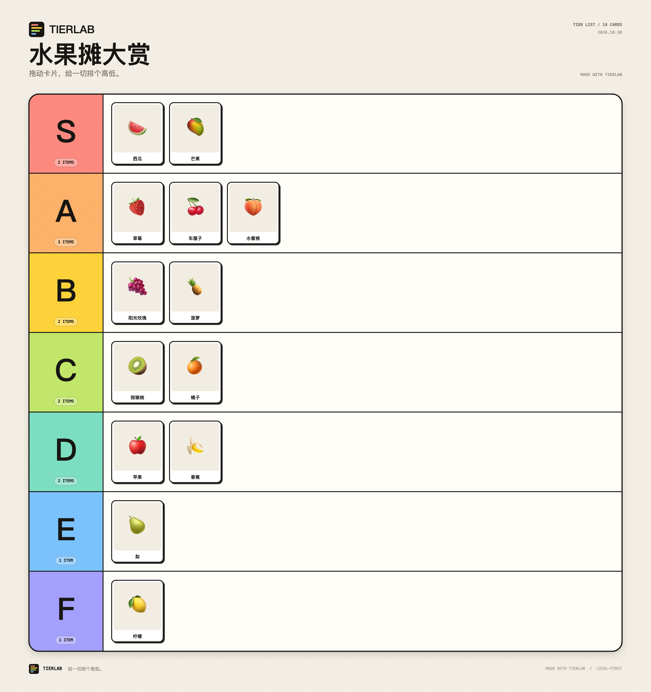
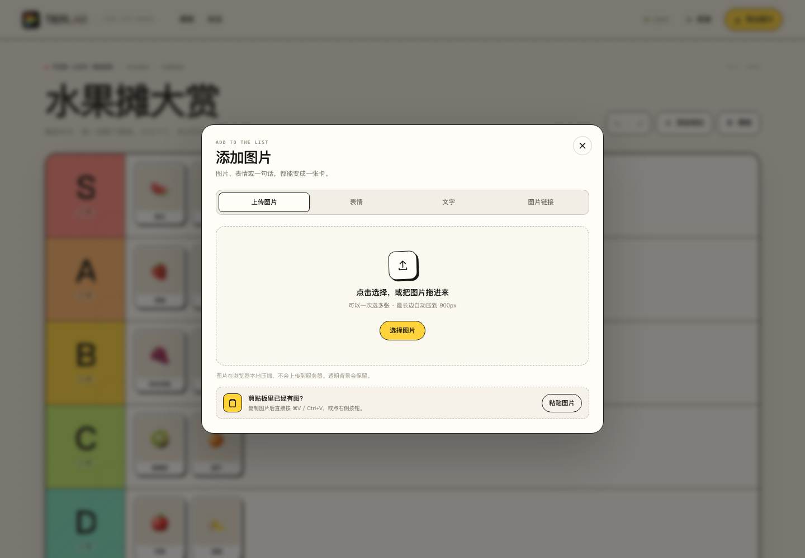

# TIERLAB · Tier List 生成器

一个不用登录、打开就能用的 Tier List 制作器。交互参考 TierMaker，但视觉和代码都是重新做的。



<p>
  
  
</p>

## 能做什么

- **拖拽分级**：鼠标或手指按住卡片，拖进任意档位；拖回素材池就取消分类。
- **点选移动**：先点选一张卡，再点任意档位即可放入，适合手机操作。
- **自定义档位**：增删档位、改名、换颜色、上下移动。所有档位颜色都是独立可调的。
- **多种素材**：上传本地图片（自动压缩）、从剪贴板粘贴图片、粘贴图片链接、用内置表情、做文字卡片。
- **模板**：内置水果、奶茶小料、游戏类型、续命水、周末片单等示例内容，一键替换。
- **自动保存**：标题、档位、卡片全部保存在浏览器 localStorage，刷新不丢。
- **撤销 / 重做**：支持按钮和键盘快捷键，误操作可撤回。
- **高清导出**：导出 2× PNG（例如 2880 × 3060），也支持复制图片到剪贴板。
- **响应式**：桌面、平板和手机都有对应布局，320px 宽度也不会横向溢出。
- **可加主屏幕**：带 iOS 主屏幕图标和 Web App Manifest，可以在手机上以独立窗口打开。



## 本地 App（macOS）


已经封装好一个原生 WebKit 容器，网页全部打包在 App 内，不需要启动浏览器或本地服务器：

- 下载压缩包：[dist/TIERLAB-1.0.1.zip](dist/TIERLAB-1.0.1.zip)
- 本地构建后双击 `dist/TIERLAB.app` 即可
- 支持 macOS 12+，Universal 二进制（Apple Silicon / Intel）

App 内部仍然使用固定的 `http://127.0.0.1:47821` 本地地址，所以剪贴板、文件选择、下载和 localStorage 的行为与网页一致，但数据存到 App 自己的容器里，**不会和网页版共享**。

原生菜单：

| 功能 | 快捷键 |
| --- | --- |
| 从剪贴板粘贴图片 | `⇧ ⌘ V` |
| 新建空白榜单 | `⌘ N` |
| 打开模板 | `⇧ ⌘ T` |
| 导出图片 | `⌘ E` |
| 重新载入 | `⌘ R` |
| 放大 / 缩小 / 实际大小 | `⌘ +` / `⌘ -` / `⌘ 0` |

重新构建：

```bash
./macos/build.sh
```

App 使用临时签名（ad-hoc），本地直接打开即可；如果通过压缩包传到另一台 Mac 后被 Gatekeeper 拦截，右键选择「打开」一次。


## iOS App

也编译了 iOS 版本，但它是 **未签名 IPA**：

- [TIERLAB-1.0.1-ios-unsigned.ipa](dist/TIERLAB-1.0.1-ios-unsigned.ipa)
- 支持 iOS 15+，arm64
- 需要朋友用 Sideloadly / AltStore 用自己的 Apple ID 重签安装（免费账号 7 天有效）

苹果要求每个 iOS App 都带开发者签名并登记设备。当前机器没有签名证书，也没有对方
设备 UDID，所以不能生成「直接发给对方就能装」的签名包。具体步骤和限制见
[ios/README.md](ios/README.md)。

iOS 版额外做了系统分享面板：导出图片时可以直接保存到相册或发给朋友。

## 部署到 GitHub Pages

仓库里已经带了一个 Pages 工作流，只会发布真正的网页文件（不会把 macOS/iOS 安装包当成站点内容）：

```text
.github/workflows/pages.yml
```

首次部署：

1. 在 GitHub 新建一个 **public** 空仓库 `tierlab`，不要勾选 README / gitignore / license。
2. 添加 remote 并推送：
   ```bash
   cd sites/tierlab
   git remote add origin git@github.com:Frigus27/tierlab.git
   git push -u origin main
   ```
3. 打开仓库的 `Settings → Pages`，把 **Build and deployment → Source** 设为 **GitHub Actions**。
4. 等 Actions 里的 “Deploy TIERLAB to GitHub Pages” 跑完。

站点地址：

```text
https://www.frigussum.com/tierlab/
```

（`frigus27.github.io/tierlab/` 会重定向到上面的自定义域名地址。）

> 第一次 push 时如果 Actions 报 `Get Pages site failed / Not Found`，说明 Pages 还没启用。
> 完成第 3 步后，在 Actions 里点一次 **Re-run all jobs** 即可。

注意：

- GitHub Pages 是纯静态托管，没有后端，所以网页版数据仍然只存在每个访客自己的浏览器里。
- `dist/` 里的 macOS / iOS 产物不会被发布到 Pages，只是放在仓库里方便下载。
- 如果之后改了 `index.html`、`styles.css`、`app.js`，提交并 push 到 `main` 就会自动重新部署。

## 本地运行

推荐用本地服务器打开，避免 `file://` 下的存储和网络限制：

```bash
cd sites/tierlab
./start-server.sh
```

然后打开 <http://127.0.0.1:4320/>。

也可以手动起一个静态服务器：

```bash
cd sites/tierlab
python3 -m http.server 4320 --bind 127.0.0.1
```

项目没有构建步骤、没有 npm 依赖，直接部署这个目录即可。macOS 原生 App 的构建见上方「本地 App」章节。

## 快捷键

| 操作 | 快捷键 |
| --- | --- |
| 撤销 | `⌘ Z` / `Ctrl Z` |
| 重做 | `⇧ ⌘ Z` / `Ctrl Y` |
| 保存到本地 | `⌘ S` / `Ctrl S` |
| 粘贴剪贴板图片 | `⌘ V` / `Ctrl V` |
| 取消选中 | `Esc` |
| 移除选中卡片 | `Backspace` / `Delete` |

## 文件结构

```text
tierlab/
├── index.html       页面结构
├── styles.css       全部样式与响应式布局
├── app.js           状态、拖拽、剪贴板、图片处理、Canvas 导出
├── favicon.svg
├── manifest.webmanifest
├── icon-180.png / icon-192.png / icon-512.png
├── start-server.sh  网页版本地服务器
├── macos/           原生 macOS 容器源码、图标、构建脚本
├── ios/             原生 iOS 容器源码、图标、构建脚本、签名说明
├── dist/            macOS App、iOS 未签名 IPA 与压缩包
└── preview/         页面与导出预览图
```

## 说明

- 数据只存在当前浏览器的 localStorage 里，不会上传到服务器。
- 本地图片会被压缩到最长边 900px，以节省存储空间；导出时使用原图裁切绘制。
- 图片链接如果被目标网站限制跨域读取，仍然可以显示，但导出时会以占位图代替。
- 浏览器清除站点数据后，榜单会一起消失。重要榜单建议导出 PNG 保存。

## 技术栈

原生 HTML / CSS / JavaScript，无框架、无构建、无外部字体或图片依赖。图片压缩使用 Canvas，导出器也是手写的 Canvas 渲染器。
